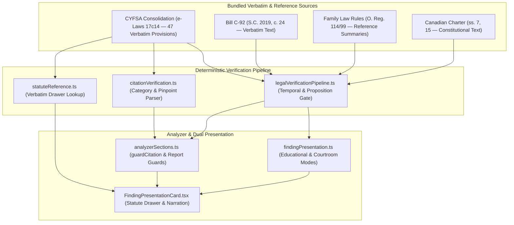

# CYFSA NAVIGATOR — MASTER LEGAL INTELLIGENCE LIBRARY
## Corrected Architecture, Verification Registry & Phased Implementation Plan

**System:** CYFSA Navigator  
**Version:** Master Architecture v1.1 (Corrected Milestone 1)  
**Target Environment:** Cloudflare Pages / Workers Edge Runtime (`migration/cloudflare-staging-20261029`) + Supabase PostgreSQL + React Frontend  
**Governance Standard:** Zero Unverified Citations • Category-Separated Authority Identifiers • Source-Existence vs Proposition-Support Separation • Tenant-Isolated Data  
**Status:** MILESTONE 1 IMPLEMENTED ON STAGING • LATER PHASES AWAITING SEPARATE APPROVAL

---

## 1. ARCHITECTURAL CORRECTIONS & MILESTONE 1 VERIFICATION SUMMARY

Following independent verification against the bundled statutory consolidations (`legal-reference/CYFSA_full_text_2026-06-24_consolidation.txt` and `legal-reference/Bill_C92_full_text.txt`), the following corrections have been enforced in both the architecture specification and the live Milestone 1 codebase:

1. **Deterministic Corpus-Backed CYFSA Verification (Not a Mixed 18-Entry List):**
   - `BUNDLED_STATUTE_ENTRIES` in `src/utils/statuteReference.ts` and `INTERNAL_CYFSA_SECTION_KEYS` in `shared/citationVerification.ts` now cover **47 verbatim CYFSA provisions** and **21 verified clause pinpoints** (`74(2)(a)` through `(n)`, `94(4)(a)`–`(b)`, `94(6)(a)`–`(c)`, `101(7)(a)`–`(c)`), all verified character-for-character against `legal-reference/CYFSA_full_text_2026-06-24_consolidation.txt`.
   - `citedSections()` deterministically parses decimal sections/subsections (`s. 9.1`, `s. 121(2.1)`), clause pinpoints (`s. 74(2)(d.1)`, `s. 94(6)(c)`, `s. 101(7)(c)`, `s. 109(2)(d)`), numbered paragraphs (`s. 1(2), para. 1`, `s. 1(2), para. 2`, `s. 101(1), para. 1`), subsection continuations (`ss. 94(1) and (2)`), and expanded subsection ranges (`s. 74(2)-(4)`).

2. **Strict Separation of Authority Categories:**
   - `INTERNAL_CYFSA_SECTION_KEYS` is strictly restricted to `CYFSA` provisions.
   - Non-CYFSA authorities use distinct category namespaces and verification rules in `shared/legalVerificationPipeline.ts`:
     - `CYFSA:*` (`verificationSourceType: "BUNDLED_CONSOLIDATION_VERBATIM"`)
     - `BILL_C92:*` (`verificationSourceType: "BUNDLED_CONSOLIDATION_VERBATIM"`, verified against `legal-reference/Bill_C92_full_text.txt`)
     - `FLR:*` (`FLR:1(8)`, `FLR:14(18)`, `FLR:14(19)`, `FLR:33` — `verificationSourceType: "REGULATION_REFERENCE_SUMMARY"`, explicitly distinguished from bundled verbatim statutes)
     - `CHARTER:*` (`CHARTER:7`, `CHARTER:15`, `CHARTER:24(1)` — `verificationSourceType: "CONSTITUTIONAL_TEXT"`)
     - `REG:*`, `OTHER_STATUTE:*`, and `CASE_LAW:*` (`verificationSourceType: "JUDICIAL_DECISION_SUMMARY"`)

3. **Distinction Between Source Existence, Temporal Validity, and Proposition Support:**
   - `resolveLegalAuthority(citationText, { caseDate, proposition })` separates:
     - `sourceExists`: Whether the cited provision exists in the verified registry.
     - `temporalStatus`: Whether the provision was in force on `caseDate` (e.g., pre-`2018-04-30` CYFSA inapplicability; `2020-01-01` Part X `s. 312(1)` and Bill C-92 commencement; `2021-03-01` `s. 121(2.1)` appeal stay; `2021-10-01` `s. 74(2)(d.1)` sex-trafficking ground; `2024-07-01` `s. 9.1` Ombudsman notice duty).
     - `propositionSupport`: `"SUPPORTED" | "IRRELEVANT_OR_MISAPPLIED" | "CONTRADICTED_BY_STATUTE" | "NOT_EVALUATED"`.

4. **Corrected Statutory Descriptions:**
   - **CYFSA Purpose Clauses (`s. 1(2), para. 1` and `s. 1(2), para. 2`):** Formatted using Ontario e-Laws numbered paragraph syntax (`s. 1(2), para. 1`, `s. 1(2), para. 2`), not `s. 1(2)(2)` or `s. 1(2)(3)`. Under `s. 1(2), para. 2`, the least disruptive course of action *"should be considered"*, whereas the operative judicial placement test is `CYFSA s. 101(2)` and `s. 101(3)` (*"would be inadequate to protect the child"*).
   - **Statutory Limits on CAS Funding Obligations (`s. 94(6)(c)` and `s. 101(7)(c)`):** While `CYFSA s. 35(1)(c)` gives societies the function to provide guidance, counselling, and other services to families, and `s. 94(4)` / `s. 101(2)`–`(3)` require the court to consider what efforts a society or another agency/person made to assist the child before removal, **CAS does not have a universal statutory duty to fund or purchase all identified family support services**. Specifically, `CYFSA s. 94(6)(c)` (interim supervision orders), `s. 101(7)(c)` (supervision orders), and `s. 116(4)(c)` explicitly stipulate that court terms and conditions on a supervising society **"shall not require the society to provide financial assistance or to purchase any goods or services."**
   - **Part X Individual Right of Access (`s. 312(1)`) vs Disclosure Without Consent (`s. 292(1)`):** An individual's right to request access to a record of personal information in a service provider's custody or control is governed by `CYFSA s. 312(1)` (and correction requests by `s. 315(2)`). `CYFSA s. 292(1)` governs disclosure of personal information *without* consent and must never be cited as the parent's right of access.
   - **Federal Bill C-92 Provisions (`ss. 10(1), 12(1), 14(1), 15, 15.1, 16(1)`):** `Bill C-92, s. 10(1)` establishes best interests as the paramount consideration in apprehension decisions; `s. 12(1)` governs mandatory notice to parents, care providers, and Indigenous governing bodies before taking any significant measure; `s. 14(1)` gives priority to preventive care services to support the child's family; `s. 15` prohibits apprehension solely on the basis of socio-economic conditions; `s. 15.1` requires reasonable efforts to have the child continue to reside with a parent or adult family member before apprehension; and `s. 16(1)` establishes the five-tier priority of placement order.

---

## 2. INFRASTRUCTURE INVENTORY & SOURCE-TO-ANALYZER FLOW

| Component | Location | Status | Role in Unified Architecture |
| :--- | :--- | :--- | :--- |
| **Official CYFSA Consolidation** | `legal-reference/CYFSA_full_text_2026-06-24_consolidation.txt` | Bundled Verbatim (683 kB) | Authoritative textual source for all 47 bundled CYFSA provisions and 21 verified clauses. |
| **Federal Indigenous Statute** | `legal-reference/Bill_C92_full_text.txt` | Bundled Verbatim | Authoritative textual source for `BILL_C92:10(1)`, `BILL_C92:12(1)`, `BILL_C92:14(1)`, `BILL_C92:15`, `BILL_C92:15.1`, `BILL_C92:16(1)`. |
| **Citation Classifier** | `shared/citationVerification.ts` | Upgraded (Milestone 1) | Category-separated instrument detection, subsection/clause/paragraph/decimal parsing, and 47-key CYFSA allowlist. |
| **Verified Authority Pipeline** | `shared/legalVerificationPipeline.ts` | Upgraded (Milestone 1) | Category-separated authority registry (`CYFSA:*`, `BILL_C92:*`, `FLR:*`, `CHARTER:*`), temporal version checking, and proposition-support validation. |
| **Frontend Statute Viewer** | `src/utils/statuteReference.ts` | Upgraded (Milestone 1) | 47 verbatim CYFSA provisions with clause resolution (`resolveBundledCyfsaKey`). |
| **Analyzer Section Pipeline** | `api/services/analyzerSections.ts` | Upgraded (Milestone 1) | Synchronized `CANONICAL_THRESHOLDS`, `CANONICAL_TIMELINES`, and proposition-aware `guardCitation`. |
| **Dual Presentation Engine** | `shared/findingPresentation.ts` | Upgraded (Milestone 1) | Synchronized `applicableAuthorityId`, `proceduralRuleAuthorityId`, and case-law summary disclosures. |

---

## 3. THE 14 CORE LEGAL COLLECTIONS — UNIFIED ARCHITECTURE PLAN

All 14 legal intelligence collections are preserved in the unified architecture plan, with explicit differentiation between **bundled verbatim statutory text** and **reference summaries / future corpus ingestions**:

| # | Collection Name | Authority Namespace | Primary Authorities & Verified Provisions | Verification Source Status & Legal Rules |
| :--- | :--- | :--- | :--- | :--- |
| **1** | **Child Protection Procedure & Deadlines** | `CYFSA:*`, `FLR:*` | `CYFSA:81(1)`, `CYFSA:81(2)`, `CYFSA:81(7)`, `CYFSA:88`, `CYFSA:90(1)`, `CYFSA:94(1)`, `CYFSA:94(2)`, `FLR:1(8)`, `FLR:33` | **5-day hearing rule (`s. 88`)** vs **30-day adjournment limit (`s. 94(1)`)**; **application (`s. 81(1)`)** vs **warrant (`s. 81(2)`)** vs **warrantless apprehension (`s. 81(7)`)**. Never cite `s. 94(5)` for the 5-day hearing deadline. |
| **2** | **Evidence & Admissibility** | `FLR:*` | `FLR:14(18)`, `FLR:14(19)` | **Firsthand observation vs hearsay**. Under `FLR:14(19)`, motion affidavits may contain information and belief only if the source is specified and the affiant states belief. Distinguish admissibility from weight. |
| **3** | **Case Law & Judicial Interpretation** | `CASE_LAW:*` | *G. (J.)*, *M. (C.)*, *P. (D.)*, *C. (S.)*, *P. (P.)*, *F.H. v. McDougall* | Tagged `JUDICIAL_DECISION_SUMMARY` until full judgments are ingested in Phase 2 Priority 3. No fabricated citations or holdings. |
| **4** | **Legal Definitions & Elements** | `CYFSA:*` | `CYFSA:1(1)`, `CYFSA:1(2)`, `CYFSA:1(2), para. 1`, `CYFSA:1(2), para. 2`, `CYFSA:2(1)`, `CYFSA:74(1)`, `CYFSA:74(2)`, `CYFSA:74(3)` | Verbatim definitions of `"parent"` (`s. 74(1)`), protection grounds (`s. 74(2)(a)`–`(n)`), and best interests (`s. 74(3)`). |
| **5** | **Court Forms & Filing Requirements** | `FLR:*` | Forms `8B`, `14A`, `14B`, `33B.1`, `33C`, `35.1A` | Official Ontario Court Forms Education Library links; never autofills or signs court forms. |
| **6** | **Procedural Fairness & Rights** | `CYFSA:*`, `CHARTER:*` | `CYFSA:3`, `CYFSA:9.1`, `CYFSA:78`, `CYFSA:78(1)`, `CYFSA:78(4)`, `CHARTER:7`, `CHARTER:15`, `CHARTER:24(1)` | Right to participate (`s. 3`), Ombudsman notice (`s. 9.1`), child legal representation (`s. 78`), and Charter `s. 7`, `s. 15`, and `s. 24(1)` remedies. |
| **7** | **Remedies, Motions & Appeals** | `CYFSA:*`, `FLR:*`, `CHARTER:*` | `CYFSA:94(4)`, `CYFSA:94(6)`, `CYFSA:101(1)`, `CYFSA:101(2)`, `CYFSA:101(3)`, `CYFSA:101(7)`, `CYFSA:102(1)`, `CYFSA:104(1)`, `CYFSA:115(2)`, `CYFSA:121(1)`, `CYFSA:121(2.1)`, `CYFSA:121(3)`, `FLR:1(8)`, `CHARTER:24(1)` | Interim care/supervision (`s. 94`), disposition (`s. 101`), custody order (`s. 102(1)`), access (`s. 104`), status review (`s. 115`), appeals (`s. 121`), order non-compliance (`FLR:1(8)`), Charter remedies (`CHARTER:24(1)`). |
| **8** | **CAS Standards, Policies & Oversight** | `CYFSA:*`, `CAS_STD:*` | `CYFSA:13(1)`, `CYFSA:35(1)`, `CYFSA:100`; Ontario Child Protection Standards (2016) | `CYFSA:35(1)` societies' functions and `CYFSA:100` Plan of Care verified verbatim; administrative OCPS Standards 1–8 scheduled for Phase 2 Priority 1. |
| **9** | **Family Law & Related Proceedings** | `CYFSA:*`, `OTHER_STATUTE:*` | `CYFSA:102(1)` (Custody order); CLRA Part III | `CYFSA:102(1)` custody orders verified verbatim; external `CLRA` citations remain marked unverified until CLRA text is bundled. |
| **10** | **Legal Education & Self-Representation** | `CYFSA:*`, `FLR:*` | All verified registry entries | Plain-language explanations paired with mandatory Law Society of Ontario / Legal Aid Ontario educational disclaimer. |
| **11** | **Document Contradiction & Provenance** | `CYFSA:*`, `FLR:*` | `locateQuote` (`shared/quoteVerification.ts`), `FLR:14(18)` | Verbatim quote location, page/offset verification, and severity caps on unlocated quotes. |
| **12** | **Historical Law & Versioning** | `CYFSA:*`, `BILL_C92:*` | Effective-date metadata (`effectiveFrom`, `effectiveTo`) on every provision | Temporal version gate in `resolveLegalAuthority` flags pre-enactment citations as `INAPPLICABLE` (`BEFORE_EARLIEST_VERSION`). |
| **13** | **Indigenous Child & Family Jurisdiction** | `CYFSA:*`, `BILL_C92:*` | `CYFSA:72`, `CYFSA:90(1)`, `CYFSA:101(4)`, `CYFSA:101(5)`, `CYFSA:109(2)(d)`, `CYFSA:123`; `BILL_C92:10(1)`, `BILL_C92:12(1)`, `BILL_C92:14(1)`, `BILL_C92:15`, `BILL_C92:15.1`, `BILL_C92:16(1)` | Verbatim coverage of band/native community consultation (`s. 72`), Indigenous placement priorities (`s. 101(5)`, `Bill C-92 s. 16(1)`), preventive care priority (`Bill C-92 s. 14(1)`), and socio-economic protection (`Bill C-92 s. 15`). |
| **14** | **Privacy, Records Access & Disclosure** | `CYFSA:*` | `CYFSA:312(1)` (Part X individual access to records) | Distinguishes individual access requests under `CYFSA s. 312(1)` from disclosure without consent under `s. 292(1)`. |

---

## 4. CAS ACCOUNTABILITY COLLECTION & VERIFICATION RULES

The **CAS Accountability Collection** links statutory duties under the CYFSA with operational and evidentiary standards:

1. **Statutory Functions vs Court-Ordered Financial Limits:**
   - Under `CYFSA s. 35(1)`, a society shall investigate allegations (`s. 35(1)(a)`), protect children where necessary (`s. 35(1)(b)`), and provide guidance, counselling, and other services to families for protecting children or preventing circumstances requiring protection (`s. 35(1)(c)`).
   - Under `CYFSA s. 100`, before the court makes a supervision or society/extended society care order under `s. 101`, the society must obtain and file a written **Plan of Care** describing the services to be provided to remedy the condition causing the child to be in need of protection.
   - Under `CYFSA s. 13(1)`, a society or person providing care must make reasonable efforts to inform a child in care of the existence and role of the Ontario Ombudsman, and under `s. 9.1` children must be informed of the Ombudsman in age-appropriate language.
2. **Distinction Between Oaths, Sworn Affidavits, and Professional Standards:**
   - CAS child protection workers act under statutory/corporate delegation (`CYFSA s. 35`, `s. 81(7)`), not a standalone statutory oath of office under the CYFSA.
   - When swearing or affirming a court affidavit (`Form 14A`, `Form 33B.1`, `Form 35.1A`), the deponent is bound by the oath/affirmation requirements of the *Evidence Act* and `FLR:14(18)`–`14(19)`.
   - Crown liability limits (`CYFSA s. 81(12)`) and good-faith execution immunity (`CYFSA s. 81(13)`, excluding *"alleged neglect or default in the execution in good faith of that duty"*) are verified verbatim in `BUNDLED_STATUTE_ENTRIES`.

---

## 5. PARENT ASSISTANCE & REUNIFICATION COLLECTION

The **Parent Assistance & Reunification Collection** enforces accurate statutory framing of family preservation, community assistance, and reunification obligations:

1. **Statutory Foundations (Verified Verbatim in Milestone 1):**
   - **Secondary Purpose (`CYFSA s. 1(2), para. 1` and `para. 2`):** So long as consistent with the best interests, protection, and well-being of children (`s. 1(1)`), additional purposes include recognizing that while parents may need help in caring for their children, that help should give support to the autonomy and integrity of the family unit and, wherever possible, be provided on the basis of mutual consent (`para. 1`), and that the least disruptive course of action that is available and is appropriate in a particular case to help a child should be considered (`para. 2`).
   - **Interim Care & Assistance Inquiry (`CYFSA s. 94(2)`, `s. 94(4)`):** Under `s. 94(4)(b)`, before making a temporary removal/care order under `s. 94(2)(b)` or `(c)`, the court shall consider **what efforts the society or another agency or person made to assist the child before intervention under Part V**.
   - **Final Disposition Community Assistance & Least Disruptive Inquiry (`CYFSA s. 101(2)`, `s. 101(3)`):** Under `s. 101(2)`, the court shall inquire into what efforts the society or another agency or person has made to assist the child before intervention under Part V. Under `s. 101(3)`, the court shall not make an order removing the child from the parent unless satisfied that **less disruptive alternatives, including non-residential services and the assistance of extended family, friends and community services, would be inadequate to protect the child**.
   - **Kinship & Indigenous Placement Priority (`CYFSA s. 101(4)`, `s. 101(5)`, `Bill C-92 s. 14(1)`, `s. 15`, `s. 15.1`, `s. 16(1)`):** Before placing a child in society care, the court must consider whether placement with a relative, neighbor, or other member of the child's community or extended family is possible (`s. 101(4)`), and for a First Nations, Inuk, or Métis child, must place the child with a member of the child's extended family or an Indigenous family unless there is a substantial reason for placing the child elsewhere (`s. 101(5)`; `Bill C-92 s. 16(1)`). Under `Bill C-92 s. 15`, an Indigenous child must not be apprehended solely on the basis of socio-economic conditions, and under `s. 15.1` reasonable efforts to keep the child with a parent or adult family member must be demonstrated before apprehension.
2. **Statutory Non-Funding Restriction (`CYFSA s. 94(6)(c)` and `s. 101(7)(c)`):**
   - Both the analyzer prompt schema and the deterministic verification pipeline (`evaluatePropositionSupport` in `shared/legalVerificationPipeline.ts`) enforce that while CAS has service-planning and assistance duties under `s. 35(1)(c)`, `s. 94(4)`, `s. 100`, and `s. 101(2)`–`(3)`, **court terms and conditions on a supervising society under `s. 94(6)(c)` and `s. 101(7)(c)` "shall not require the society to provide financial assistance or to purchase any goods or services."** Any proposition claiming a universal CAS duty to pay for or purchase private goods or services is deterministically rejected as `CONTRADICTED_BY_STATUTE`.

---

## 6. NEXT-PHASE IMPLEMENTATION PLAN (NOT EXECUTED — AWAITING SEPARATE APPROVAL)

In accordance with Milestone 1 governance instructions, later phases are **not executed** in this milestone and are prepared for separate review and approval in the following priority order:

1. **Priority 1 — CAS Statutory and Operational Standards:**
   - Ingest authoritative verbatim excerpts of the *Ontario Child Protection Standards (2016)* (Standards 1–8) and *Ontario Eligibility Spectrum* into a dedicated `CAS_STANDARD` authority category (`CAS_STD:*`) with explicit differentiation between mandatory ministry standards and discretionary clinical guidance.
2. **Priority 2 — Parent Assistance and Reunification Obligations:**
   - Implement the structured Parent Assistance Compliance Matrix linking `CYFSA s. 1(2), para. 1–2`, `s. 35(1)(c)`, `s. 94(4)`, `s. 100`, `s. 101(2)–(5)`, `s. 94(6)(c)`, `s. 101(7)(c)`, and `Bill C-92 ss. 14–16` to document-level service-plan and pre-removal assistance audits.
3. **Priority 3 — Structured Case-Law Verification:**
   - Build a structured `CASE_LAW:*` verification registry with verified neutral citations, court hierarchy, decision dates, and verbatim ratio excerpts from authoritative public-domain court decisions so case-law references transition from `JUDICIAL_DECISION_SUMMARY` to source-verified holdings.
4. **Priority 4 — Historical Procedure and Deadline Validation:**
   - Expand consolidation-period snapshots (including pre-April 30, 2018 *Child and Family Services Act*, R.S.O. 1990, c. C.11 mappings and historical *Family Law Rules* subrule amendments) and calendar-day vs court-day deadline calculators under `FLR Rule 3`.
