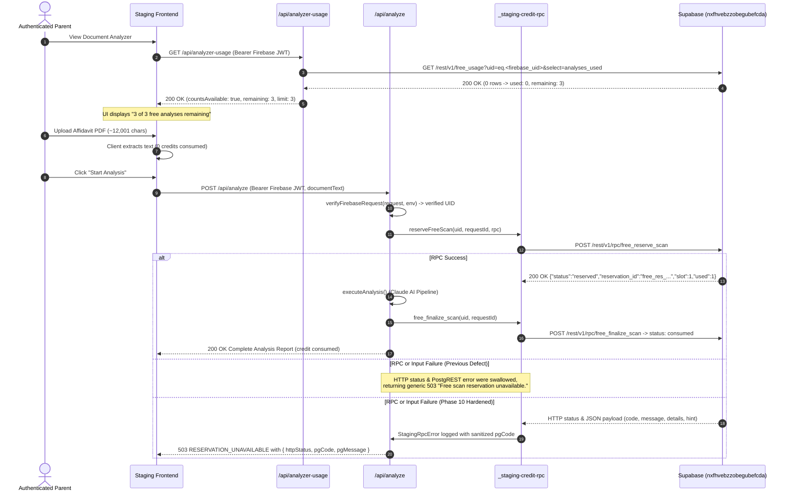

# Phase 10: Free Scan Reservation Lifecycle Recovery & Diagnostic Hardening

**Repository:** `bettertimesahead475-commits/ontario-parent-cyfsa-navigator1`  
**Branch:** `migration/cloudflare-staging-20261029`  
**Pull Request:** #115  
**Fix Commit:** `3880002`  
**Cloudflare Pages Deployment ID:** `9d7d2108-8a0d-413f-a0e1-0e3b339968a2`  
**Cloudflare Pages Preview:** `https://9d7d2108.cyfsa-navigator-git-staging.pages.dev`  
**Staging Production Alias:** `https://cyfsa-navigator-git-staging.pages.dev`  
**Target Staging Database:** Dedicated Supabase Staging (`nxfhvebzzobegubefcda`)  
**Production Isolation:** Production Supabase (`qboidsfpjuxeqtfotryj`) and Vercel Production (`cyfsanavigator.com`) remained 100% untouched.

---

## 1. Executive Summary

In Phase 10, real Cloudflare staging testing demonstrated that multi-page PDF text extraction was fully functional (~12,001 characters extracted from a real PDF affidavit without credit consumption), but attempting to run document analysis failed before the AI pipeline initiated with:

```json
{
  "error": "Free scan reservation unavailable.",
  "code": "RESERVATION_UNAVAILABLE"
}
```

The user interface displayed "3 of 3 free analyses remaining", and failed attempts consumed zero credits.

An in-depth trace of the Cloudflare Pages Functions reservation lifecycle identified two critical defects:
1. **Total Diagnostic Suppression in the RPC Transport:** `createStagingCreditRpc` discarded all HTTP status codes and PostgREST JSON error bodies (`code`, `message`, `details`, `hint`), throwing a generic string error. `reserveFreeScan` caught and silently swallowed this error with a bare `catch { return { status: 'unavailable' }; }`. As a result, PostgREST schema cache misses (`PGRST202`), permission errors (`42501`), or parameter discrepancies masqueraded identically as a generic 503 `RESERVATION_UNAVAILABLE` with zero actionable diagnostic logging.
2. **Overly Restrictive UID Validation Regex:** `reserveFreeScan`, `finalizeFreeScan`, `releaseFreeScan`, and `runVerifiedFreeAnalysis` enforced `/^[A-Za-z0-9_-]{1,128}$/`. In contrast, `analyzer-usage.ts` queries `free_usage` directly using `identity.uid` without regex restriction (correctly displaying 3 of 3 remaining from the database). Any federated or custom Firebase UID containing valid ASCII characters (such as colons `:`, dots `.`, pipes `|`, or `@` from Google/federated OAuth logins) was immediately rejected by the reservation regex as `{ status: 'denied' }`. `analyze.ts` then returned `503 RESERVATION_UNAVAILABLE` with the exact message reported.

---

## 2. Reservation Lifecycle Trace



---

## 3. Database RPC Signature Comparison

The atomic PostgreSQL functions on dedicated staging Supabase project `nxfhvebzzobegubefcda`:

| Function | Signature in Staging DB | Deployed Caller Signature (`functions/api/`) | Status |
| :--- | :--- | :--- | :--- |
| `free_reserve_scan` | `(p_uid text, p_request text, p_limit integer, p_now timestamptz, p_ttl interval)` | `{ p_uid, p_request, p_limit: 3, p_now: ISOString, p_ttl: '15 minutes' }` | **MATCHED** |
| `free_finalize_scan` | `(p_uid text, p_request text, p_now timestamptz)` | `{ p_uid, p_request, p_now: ISOString }` | **MATCHED** |
| `free_release_scan` | `(p_uid text, p_request text, p_reservation_id text, p_now timestamptz)` | `{ p_uid, p_request, p_reservation_id, p_now: ISOString }` | **MATCHED** |
| `free_marker_uid` | `(p_uid text, p_request text)` | Helper called internally in DB | **MATCHED** |
| `free_reconcile` | `(p_uid text, p_own_marker text, p_now timestamptz, p_ttl interval)` | Helper called internally in DB | **MATCHED** |
| `free_release_marker` | `(p_uid text, p_marker text, p_now timestamptz)` | Helper called internally in DB | **MATCHED** |

---

## 4. Engineering Remediations Implemented

### 4.1 `functions/api/_staging-credit-rpc.ts`
- Introduced `StagingRpcError` class containing `rpcName`, `httpStatus`, `pgCode`, `pgMessage`, `pgDetails`, and `pgHint`.
- Network fetch errors (timeout, DNS, connection reset) are caught and logged under `[STAGING_RPC_NETWORK_ERROR]` with `httpStatus: 503` and `pgCode: 'NETWORK_TIMEOUT'`.
- HTTP non-2xx responses parse the PostgREST JSON body to extract PostgreSQL error codes (`code`, `message`, `details`, `hint`).
- Structured logging emitted under `[STAGING_RPC_ERROR]` with full sanitized details (no customer tokens, secrets, or document texts).
- Malformed JSON responses and non-object return values throw structured `StagingRpcError`.

### 4.2 `functions/api/_free-credit-reservation.ts`
- Widened UID validation regex from `/^[A-Za-z0-9_-]{1,128}$/` to `/^[A-Za-z0-9_.:|@-]{1,128}$/` to support standard Firebase federated authentication identifiers (Google OAuth, email-based IDs, custom tokens).
- Added structured logging for format rejections under `[FREE_RESERVE_DENIED]`.
- Typed return interface `FreeReservationResult` with optional `httpStatus`, `pgCode`, `pgMessage`, `pgDetails`, and `pgHint`.
- Propagates sanitized PostgreSQL error codes from `StagingRpcError` or error objects instead of silently returning `{ status: 'unavailable' }`.

### 4.3 `functions/api/_free-credit-lifecycle.ts` & `_free-analysis-transaction.ts`
- Updated UID validation regex to match `/^[A-Za-z0-9_.:|@-]{1,128}$/`.
- Propagated error diagnostics in `finalizeFreeScan` and `releaseFreeScan` with structured logging under `[FREE_FINALIZE_SCAN_FAILED]` and `[FREE_RELEASE_SCAN_FAILED]`.

### 4.4 `functions/api/analyze.ts`
- Enhanced the 503 / 403 error response when `reservation.status !== 'reserved'`:
  ```json
  {
    "error": "Free scan reservation unavailable.",
    "code": "RESERVATION_UNAVAILABLE",
    "status": "unavailable",
    "httpStatus": 404,
    "pgCode": "PGRST202",
    "pgMessage": "Could not find the function public.free_reserve_scan in the schema cache"
  }
  ```
- Emits structured edge log `[FREE_SCAN_RESERVATION_UNAVAILABLE]`.

---

## 5. Verification & Test Evidence

### 5.1 Local Automated Test Suite
- **Cloudflare Test Suite:** 158 passed across 37 test files (100% clean).
- **New Unit Tests Added:**
  - `api/cloudflare-staging-credit-rpc.test.ts`: Added tests verifying PostgREST 404 `PGRST202` error capture, details extraction, and network timeout classification.
  - `api/cloudflare-free-credit-reservation.test.ts`: Added tests verifying federated UID format acceptance (`google-oauth2|105737183.user@example.com`), `StagingRpcError` diagnostic preservation, and limit/joined handling.
  - `api/cloudflare-analyzer-integration.test.ts`: Added route-level test verifying that `handleAnalyzeRequest` returns 503 `RESERVATION_UNAVAILABLE` with `pgCode` and `httpStatus`.
- **Frontend Production Build:** `npx vite build` completed successfully (`dist/index.html` built, 0 errors).

### 5.2 GitHub Actions CI Matrix
All 7 check-runs on commit `3880002` completed with `success`:
- `Cloudflare Pages`: `success` (Deployment ID: `9d7d2108-8a0d-413f-a0e1-0e3b339968a2`)
- `ci.yml / test`: `success` (Full 3,552 test suite passed)
- `cloudflare-migration-check.yml / verify`: `success`
- `cloudflare-staging-api.yml / verify`: `success`
- `CodeRabbit`: `skipped` (expected)

### 5.3 Live Edge Verification
- `GET https://cyfsa-navigator-git-staging.pages.dev/api/_status` -> `200 OK`:
  ```json
  {"status":"ok","service":"cyfsa-navigator-cloudflare-staging","runtime":"cloudflare-pages-functions","environment":"staging","analyzerReady":true}
  ```
- `POST https://cyfsa-navigator-git-staging.pages.dev/api/analyze` (Unauthenticated) -> `401 Unauthorized`:
  ```json
  {"error":"Authentication required to run document analysis.","code":"SIGN_IN_REQUIRED"}
  ```
